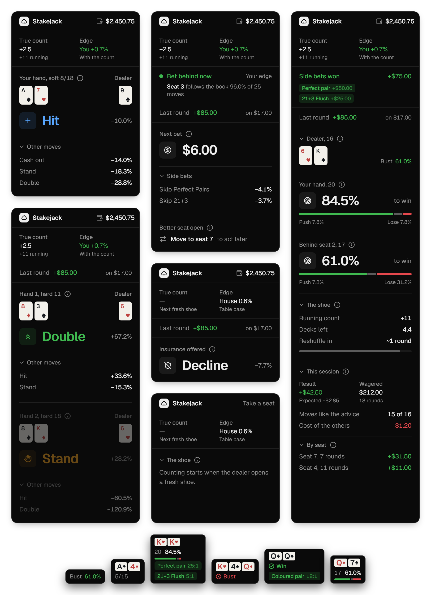

# Stakejack



A browser extension for Pragmatic Play Live Blackjack on Stake. It reads the table you're sitting at and tells you the best play for your hand, what to bet, and how the count is running. It only watches the game. It never clicks or bets for you.

## Install

**Firefox.** Download the `.xpi` file from the latest release. Firefox will ask whether to add Stakejack. Click Add, and you're done. It stays installed and updates when you install a newer file.

**Chrome, Edge or Brave.** Download the Chrome `.zip` from the latest release and unzip it somewhere you won't delete it, like your Documents folder. Type `chrome://extensions` into the address bar and press Enter. Switch on Developer mode in the top right corner, click Load unpacked, and pick the unzipped folder. Keep that folder, because Chrome loads the extension from it.

Then open Live Blackjack on Stake. A small Stakejack window appears in the top right of the game. You can drag it anywhere by its title, double click the title to put it back, and use the arrow beside your balance to shrink it down to just the count. It stays on screen when the window is resized. Tap the (i) next to any heading to see what it means.

Small chips sit on the table above every hand and beside the dealer's score, showing the cards, each hand's chance to win and the dealer's chance to bust. Hover or tap a chip for the full breakdown. Between hands the window also shows the shoe, roughly how long until the reshuffle, and your session: rounds, money wagered, your result next to what was expected, and how often your moves matched the advice.

## Build it yourself

Use pnpm:

```sh
pnpm install
pnpm build:all
```

In Chrome, open `chrome://extensions`, turn on developer mode, choose Load unpacked and pick `.output/chrome-mv3`. In Firefox, open `about:debugging#/runtime/this-firefox` and load `.output/firefox-mv3/manifest.json` as a temporary add-on. Regular Firefox only keeps signed add-ons, so for a permanent install run `pnpm sign:firefox` with your addons.mozilla.org API key in `WEB_EXT_API_KEY` and `WEB_EXT_API_SECRET`.

Reload the blackjack table after installing and the panel shows up in the game.

## How it works

The extension listens to the game's own WebSocket, plus the wallet and table config requests the client already makes. From that it knows your seat, every card on the table and your balance.

Moves come from an exact expected value calculation for this table's rules: eight decks, dealer stands on soft 17, double after split, one split, and a dealer who only checks for blackjack behind an ace. That last rule means doubles and splits lose to a dealer blackjack behind a ten, which changes a few book plays, like 11 against a 10.

Once it has seen a shoe from the first card, it keeps a Hi-Lo count, adjusts plays to the cards left and sizes your bet with half Kelly. When the count gives you the edge, the window says so. The count is saved per table, so a reload picks up where it left off.

Bets behind another player get their own advice, and cash out is compared against that player's stake. A cash out quote that can't be matched to the bet it was priced on is left out rather than shown as a huge gain.

## Releasing

Firefox installs keep themselves up to date: the add-on checks `updates.json` on the latest GitHub release about once a day and installs any newer signed version it lists. To publish a version:

```sh
pnpm sign:firefox
pnpm zip
pnpm release:prepare
```

The last step gathers the signed Firefox package, the Chrome zip and `updates.json` into `.output/release-<version>` and prints the `gh release create` command that publishes them. The repository has to be public for Firefox to reach the update list.

## Development

`pnpm dev` runs a live build. `pnpm typecheck`, `pnpm lint` and `pnpm format:check` keep the code clean. `pnpm replay <capture.json>` runs a recorded session through the advisor, and `pnpm tsx scripts/strategy-chart.ts` prints the full strategy chart. The built extension also includes `preview.html`, which renders every panel state from sample hands.
